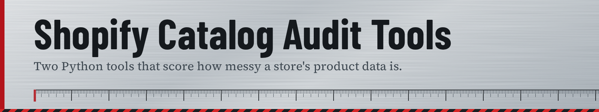

# Shopify Catalog Audit Tools

  

Two small Python tools for auditing the product data of Shopify stores, built for freelance data-cleanup work with independent tool, hardware, welding and auto-parts retailers.

- **`shopify_prospect_scorer.py`** reads the public `/products.json` of each store in a list and scores how messy the catalog is (duplicates, missing SKUs, vendor spelling variants, thin descriptions, inconsistent units).
- **`thin_description_sampler.py`** finds products with missing or placeholder descriptions, draws a random sample, and writes a spot-check list plus a work sheet for rewriting them from manufacturer specs.

Both tools only read data that a store already publishes to every visitor. They do not log in, modify anything, or bypass any protection.

## Install

Requires Python 3.9+.

```
pip install -r requirements.txt
```

## Usage

```
# Try it with built-in demo data (no network needed)
python shopify_prospect_scorer.py --demo
python thin_description_sampler.py --demo

# Score real stores: one domain per line in domains.txt
python shopify_prospect_scorer.py domains.txt --max-pages 60

# Sample thin descriptions for one store
python thin_description_sampler.py example-store.com --sample 30
```

Copy `domains.example.txt` to `domains.txt` and add your own list. Lines starting with `#` are ignored. Stores that are not on Shopify, or that disable `/products.json`, are skipped and marked in the output.

## What the scorer measures

| Signal | Why it matters |
|---|---|
| Duplicate products (titles identical after normalising case, punctuation and units such as `20 Volt` = `20V`) | Split inventory, reporting and SEO |
| Missing and duplicate SKUs | Breaks inventory sync |
| Vendor spelling variants (`DeWalt` / `DEWALT` / `Dewalt `) | Brand filters and reports are wrong |
| Empty or very short descriptions | Weak search visibility, missing specs |
| Inconsistent unit formats in titles | Hard to filter and compare |
| Zero or missing prices | Data entry errors |

Opportunity score = issue score x catalog size, so large and messy ranks above small and messy.

### Design notes

- **No fuzzy matching.** An early version used fuzzy title matching (rapidfuzz) and produced false positives on products that differ by colour code (`-R` red vs `-O` orange), model number or size. Only titles that are identical after normalisation are counted as duplicates, which understates duplicates but never invents them.
- The scan is capped by `--max-pages` (250 products per page). A catalog that hits the cap is larger than the number reported.
- Description "thin" means under 40 characters of text (`--min-chars`). Some stores keep specs elsewhere on the page, so spot-check before drawing conclusions. The sampler writes the URLs for this.
- Attributes extracted from titles (model code, voltage, drive size, torque) are starting points for lookup, not verified data.

## Responsible use

- Request rate is deliberately slow (1.5 s between pages by default). Do not lower it.
- Rewritten descriptions should come from the manufacturer's own published specifications, with a source link for every product, not from other retailers' product pages.
- Do not publish another business's data or audit results without their permission.

## Files

| File | Purpose |
|---|---|
| `shopify_prospect_scorer.py` | Score a list of stores |
| `thin_description_sampler.py` | Sample thin descriptions for one store |
| `domains.example.txt` | Example input |
| `sample_output/` | Output generated from the built-in demo data |

## License

MIT. See `LICENSE`.
